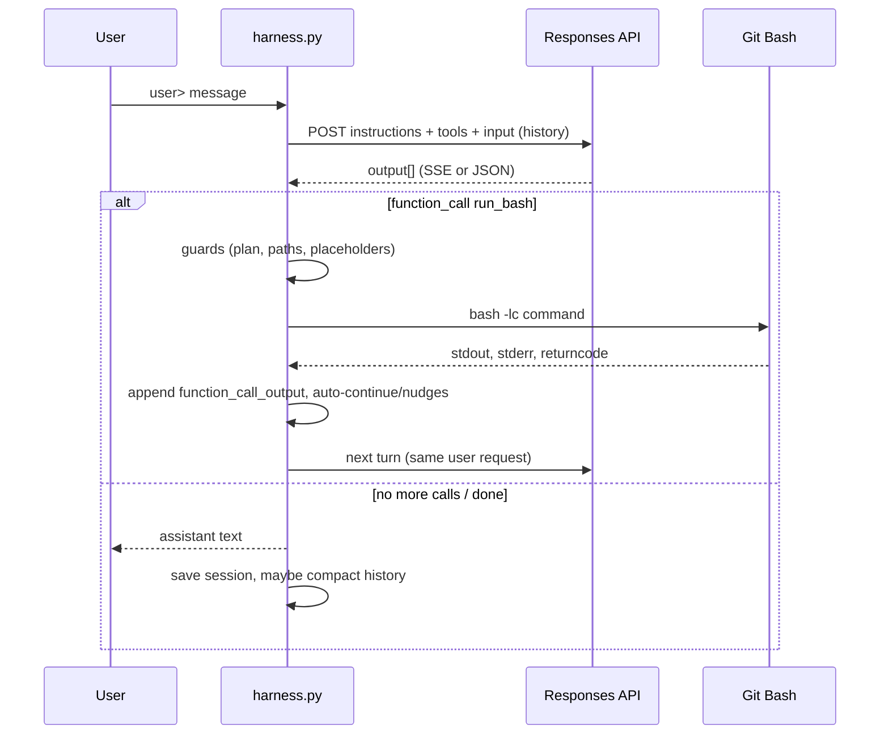

# Harness

Terminal **REPL** that talks to a **Responses-compatible API** (`POST /v1/responses`) and runs real shell commands on your machine via a single tool — `run_bash`. Typical default: **Ollama** on `http://127.0.0.1:11434` with a model that supports tools (e.g. `llama3.1:8b`). You can point the same client at **CursorProxyCli** or any compatible proxy.

---

## What this project is for

| Goal | How harness helps |
|------|-------------------|
| Local LLM agent with tools | Ollama (or proxy) + `run_bash` loop |
| Auditable CLI work | Every action is a logged bash command + JSON result in history |
| Windows-friendly execution | Git Bash (`bash -lc`) when available; optional `BASH_PATH` |
| Long sessions | Optional persisted history + LLM compaction (`harness_history.py`) |
| Safer / steadier small models | Harness nudges, path guards, plan/execution discipline (`harness.txt` + Python guards) |

This is still a **small** codebase (not a full agent framework): one tool, no sandbox, no plugins. Guardrails are prompt + lightweight checks in Python, not a policy engine.

---

## Architecture



**Modules:**

| File | Role |
|------|------|
| `harness.py` | REPL, API client (stream + non-stream), agent loop, tool runner, guardrails, auto-continue |
| `harness.txt` | System instructions (loaded each API call; not a duplicate paste-only doc) |
| `harness_history.py` | Session JSON, turn metrics, optional LLM compaction of old turns |
| `harness_history.txt` | Prompt used when compacting history |
| `harness_status.py` | `[status]` lines on stderr (LLM wait, tool run, history budget) |

User sample data (e.g. PDFs under `faturas/`) is **not** part of the harness; keep it gitignored as needed.

---

## Agent loop (per user message)

1. Append `{ role: user, content }` to `history`.
2. **Inner `chat()` loop** until the model stops calling tools and the harness accepts the turn as complete:
   - `POST` full `history` + `instructions` from `harness.txt` + `run_bash` tool schema.
   - Supports **SSE streaming** when `LLM_STREAM=1` (live stdout/stderr from commands while they run).
   - Execute each `function_call` → `run_bash`; scrape JSON tool plans from assistant text if the model forgot formal tool calls.
   - **Auto-continue**: inject `[harness] …` user messages to keep going after failures, missing plans, batch jobs, “Pending: …” without tools, etc. (cap: `HARNESS_MAX_AUTO_CONTINUE`).
   - Optional **plan gate** (`HARNESS_REQUIRE_PLAN`): first publish a plan in assistant text, then execute (see `harness.txt`).
   - Optional **scope verify** (`HARNESS_SCOPE_VERIFY`) before finishing a turn.
3. After the turn: persist session (`harness_history`), maybe compact, print history usage on stderr.

**Chained shell** (`mkdir -p x; for f in …; done`) is allowed in **one** `run_bash` — the whole string is passed to `bash -lc`. Failures are usually wrong commands or model quoting, not a “one command per call” limit.

---

## Tool: `run_bash`

| Aspect | Behavior |
|--------|----------|
| Schema | OpenAI-style function, `strict: true`, field `command` (string) |
| Timeout | **60s** per invocation |
| Output cap | Last **8000** chars of stdout and stderr each in the JSON returned to the model |
| Unix | `shell=True`, `executable=/bin/bash` |
| Windows | `["bash", "-lc", command]` when Git Bash is found (not WSL store bash); else `shell=True` |
| Guards (examples) | Placeholder paths; plan text in bash; unknown **input** paths vs recent `ls` (outputs like `pdftotext` `.txt` targets are allowed); duplicate success same turn; optional plan-before-first-tool |

Tool results are JSON: `{ "command", "returncode", "stdout", "stderr" }`.

---

## API client

- **Stdlib only** (`urllib`, `json`).
- Optional `Authorization: Bearer` if `OPENAI_API_KEY` is set.
- Default endpoint: **Ollama** `http://127.0.0.1:11434/v1/responses` (not the old `8765` Cursor proxy default).
- `ensure_model_support()` warns if the model lacks `tools` in Ollama tags.
- Streaming: Server-Sent Events; `harness_status` reports wait/generation milestones.

---

## Configuration (`.env`)

Loaded at startup; does not override variables already set in the shell.

### LLM

| Variable | Default | Purpose |
|----------|---------|---------|
| `LLM_API` | `http://127.0.0.1:11434/v1/responses` | Responses URL |
| `LLM_MODEL` | `llama3.1:8b` | Model name (must support tools on Ollama) |
| `LLM_STREAM` | `1` | `0`/`false` = non-streaming API + bulk print of assistant text |
| `OPENAI_API_KEY` | (unset) | Optional bearer for proxies that require it |
| `BASH_PATH` | (auto) | Path to Git `bash.exe` on Windows |

### Harness behavior

| Variable | Default | Purpose |
|----------|---------|---------|
| `HARNESS_MAX_AUTO_CONTINUE` | `16` | Max inner-loop nudges per user message |
| `HARNESS_REQUIRE_PLAN` | `1` | Require a written plan before first `run_bash` (set `0` to disable) |
| `HARNESS_SCOPE_VERIFY` | `1` | Final self-check nudge before returning to `user>` |
| `HARNESS_STATUS` | `1` | `[status]` lines on stderr |

### Session history

| Variable | Default | Purpose |
|----------|---------|---------|
| `HARNESS_HISTORY_ENABLED` | `1` | Persist conversation under `.harness_state/` |
| `HARNESS_HISTORY_FILE` | `.harness_state/session.json` | Session path |
| `HARNESS_HISTORY_COMPACT_EVERY` | `6` | Compact after N user turns |
| `HARNESS_HISTORY_MAX_CHARS` | `48000` | Soft budget before compaction |
| `HARNESS_HISTORY_KEEP_USER_TURNS` | `4` | Recent user turns kept verbatim when compacting |

---

## Requirements

- **Python 3** (e.g. 3.14); stdlib only for the harness itself
- **Ollama** (or another `/v1/responses` server) with a tool-capable model
- **Git Bash** on Windows (recommended for `pdftotext`, loops, Unix paths)
- Optional: `poppler` / `pdftotext` on `PATH` for PDF tasks

---

## Usage

1. Start Ollama (or your proxy) and pull a model with tools, e.g. `ollama pull llama3.1:8b`.
2. Copy or edit `.env` (see above).
3. From this directory:

```bash
python harness.py
```

4. Type at `user> `. Empty lines are ignored. EOF (Ctrl+D) exits.

Session resumes from `.harness_state/session.json` when history is enabled.

---

## Repo layout (harness code)

| Path | Purpose |
|------|---------|
| `harness.py` | Main entrypoint |
| `harness.txt` | Agent system prompt |
| `harness_history.py` / `harness_history.txt` | Persistence + compaction |
| `harness_status.py` | Progress logging |
| `.gitignore` | `.env`, `.harness_state/`, `.harness_tmp/`, `__pycache__/`, local data dirs |
| `README.md` | This file |

---

## Security and limitations

- Commands run **as your user**, no sandbox.
- Guardrails reduce common model mistakes (invented paths, fake “done”, plan loops); they do **not** replace judgment — treat untrusted models as unsafe.
- 60s timeout and 8k truncation can hide detail from the model.
- One command string per `run_bash` invocation (but that string may contain `;`, `&&`, loops).
- HTTP errors exit the process (`SystemExit`).

For production-style agents you would add policy, sandboxing, and richer tools; this repo stays a minimal, hackable loop.

---

## Related: CursorProxyCli

A **.NET** publish of **CursorProxyCli** can expose the same HTTP shape on port `8765`; set `LLM_API` and `LLM_MODEL` accordingly. The harness is only an HTTP client — it does not bundle Cursor or Ollama.