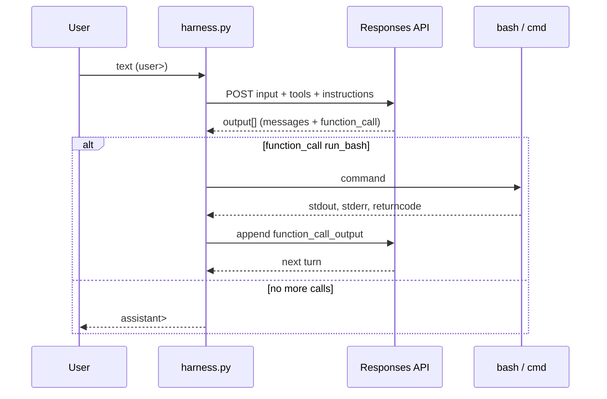

# Harness

A minimal **terminal REPL** that drives a remote or local **Cursor-compatible Responses API** and closes the loop by running real shell commands on your machine. The model only gets one tool — `run_bash` — so every filesystem or command-line action goes through a single, auditable path.

Typical setup: run **CursorProxyCli** (or any server that implements `POST /v1/responses` like OpenAI’s Responses shape), point this harness at it, and chat from `user> ` while the assistant inspects your project via bash.

---

## What this project is for

| Goal | How harness helps |
|------|-------------------|
| Test a local LLM proxy without the full Cursor IDE | Same API + tool protocol, plain Python + stdlib |
| Scriptable “agent in the terminal” | Multi-turn history; tool outputs are fed back until the model stops calling tools |
| Windows-friendly command execution | Prefer Git Bash over `cmd`; configurable `BASH_PATH` |

This is **not** a production agent framework: no plugins, no sandbox, no parallel tools. It is a small reference implementation (~150 lines) meant for learning and hacking on the proxy ↔ client contract.

---

## Architecture



**Components:**

1. **`harness.py`** — Loads `.env`, maintains conversation `history`, calls the API in a loop until there are no pending `function_call` items.
2. **Upstream API** — Expected at `LLM_API` (default `http://127.0.0.1:8765/v1/responses`). Payload includes `model`, `instructions` (system prompt), `tools`, and `input` (prior turns + tool results).
3. **`run_bash` implementation** — Runs the model’s command locally and returns JSON: `{ command, returncode, stdout, stderr }`.

The published **CursorProxyCli** folder (`net8.0-windows`) is one possible server that listens on that port and forwards to Cursor’s agent runtime; this harness is the **client** side of that experiment.

---

## Agent loop (detailed)

For each user line:

1. Append a user message to `history`.
2. **Inner loop (`chat`)**:
   - `POST` the full `history` to the Responses endpoint.
   - Append the response’s `output` array to `history` (model messages and tool calls in API-native form).
   - Collect every item with `type == "function_call"`.
   - If there are **no** function calls, extract assistant text from `output` messages (`output_text` parts), print `assistant> …`, and return to the `user> ` prompt.
   - For **each** function call:
     - Parse `arguments` JSON and read `command`.
     - Print `$ <command>` for transparency.
     - Run `run(command)` and print stdout/stderr to the terminal.
     - Append `{ type: "function_call_output", call_id, output }` where `output` is the JSON string from `run`.
   - Repeat the inner loop so the model can chain multiple commands before answering.

The system prompt (also mirrored in `harness.txt`) tells the model to always use `run_bash` for inspection, never fake command output, respect return codes, and ask before destructive operations unless the user already asked.

---

## Tool: `run_bash`

| Aspect | Behavior |
|--------|----------|
| Schema | OpenAI-style function tool, `strict: true`, single required field `command` (string) |
| Timeout | 60 seconds per command |
| Output cap | Last **8000** characters of stdout and stderr each (avoids blowing the context window) |
| Unix | `shell=True`, executable `/bin/bash` |
| Windows | If Git Bash (or `BASH_PATH`) is found and is **not** WSL/system `bash.exe`, runs `bash -lc "<command>"`; otherwise falls back to `cmd` via `shell=True` |
| WSL guard | Skips paths like `system32\bash.exe` and `WindowsApps` so you don’t accidentally hit the wrong bash |

Tool results are **only** what `run` returns; the human also sees raw stream output in the console.

---

## API client (`api()`)

- Uses **stdlib only**: `urllib.request` + `json` (no `openai` package).
- `Content-Type: application/json`.
- If `OPENAI_API_KEY` is set in the environment, sends `Authorization: Bearer …` (useful if your proxy expects a key).
- On HTTP error, prints the response body and exits.

Request shape (simplified):

```json
{
  "model": "composer-2.5",
  "instructions": "<SYSTEM prompt>",
  "tools": [ { "type": "function", "name": "run_bash", ... } ],
  "input": [ ... prior turns, function_call, function_call_output ... ]
}
```

The harness assumes the response includes an `output` list compatible with Cursor/OpenAI Responses (message items with `output_text`, and `function_call` items with `call_id` and `arguments`).

---

## Configuration

Create or edit `.env` in this directory (loaded on startup via `load_env()`; does not override variables already set in the shell):

| Variable | Default | Purpose |
|----------|---------|---------|
| `LLM_API` | `http://127.0.0.1:8765/v1/responses` | Responses endpoint URL |
| `LLM_MODEL` | `composer-2.5` | `model` field in each request |
| `OPENAI_API_KEY` | (unset) | Optional bearer token for the proxy |
| `BASH_PATH` | (auto) | Full path to `bash.exe` on Windows |

`load_env` ignores blank lines, `#` comments, and supports quoted values.

---

## Requirements

- **Python 3** (developed with 3.14; uses only stdlib)
- **Optional:** [Git for Windows](https://git-scm.com/) for a sane `run_bash` experience on Windows
- A running **Responses API** listener (e.g. **CursorProxyCli.exe** on port `8765`)

---

## Usage

1. Start your proxy (example: run `CursorProxyCli.exe` from the publish folder).
2. Configure `.env` if the default URL or model is wrong.
3. From this directory:

```bash
python harness.py
```

4. Type at `user> `. End with Ctrl+D (EOF) or close stdin to quit.

Example session flow: you ask to list files → model emits `run_bash` → you see `$ ls …` and command output → model may call again → finally `assistant>` with a summary.

---

## Files in this repo

| File | Purpose |
|------|---------|
| `harness.py` | REPL, API client, tool runner, agent loop |
| `harness.txt` | Copy of the system prompt (documentation / paste into other clients) |
| `.env` | Local secrets and URLs (keep out of version control) |
| `README.md` | This document |

---

## Security and limitations

- Commands run **as your user** with no sandbox. The model can read, modify, or delete anything your shell can. Use only with trusted models and on machines you’re willing to expose.
- There is no allowlist of commands, no working-directory jail, and no confirmation UI — only the system prompt’s “ask before destructive commands.”
- Long command output is truncated; the model may miss details beyond the last 8k characters per stream.
- Single-threaded: one command at a time per turn batch.
- Network errors and non-JSON failures terminate the process (`SystemExit` on HTTP errors).

For production-style agents, you would add sandboxing, policy hooks, logging, and a richer tool surface; this repo intentionally stops at the smallest working loop.

---

## Related: CursorProxyCli

The sibling publish layout under `Documents\net8.0-windows\net8.0-windows` contains **CursorProxyCli** — a .NET 8 Windows build that exposes the HTTP API this harness calls. Together they form a **proxy + CLI client** pair for experimenting with “Cursor agent mode” outside the editor. This harness does not embed Cursor; it only speaks HTTP to whatever implements `/v1/responses`.